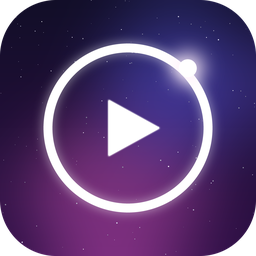
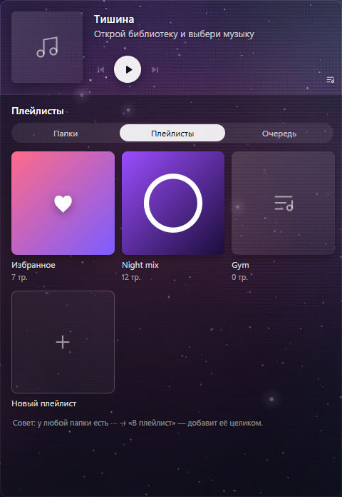
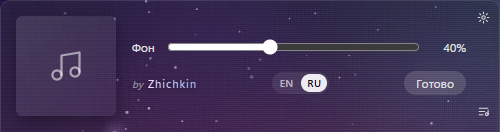

<p align="center">
  
</p>

<h1 align="center">Carina</h1>

<p align="center">
  Лёгкий аудиоплеер для Windows: стеклянный виджет на рабочем столе и проводник музыки, который раскрывается прямо из него.
  <br><sub>by Zhichkin</sub>
</p>

<p align="center">
  <a href="https://github.com/zhichkin44-del/carina-player/releases/latest"><b>⬇ Скачать установщик</b></a>
</p>

<p align="center">
  
  &nbsp;
  
</p>

## Установка

1. Откройте [Releases](https://github.com/zhichkin44-del/carina-player/releases/latest) и скачайте `Carina_<версия>_x64-setup.exe` (≈ 2 МБ).
2. Запустите. Права администратора не нужны: Carina ставится для текущего пользователя.
3. Виджет появится в правом нижнем углу. ☰ при наведении открывает библиотеку, ⚙ открывает настройки.

Установщик регистрирует Carina для аудиофайлов: «Открыть с помощью → Carina» играет всю папку начиная с выбранного трека.

## Возможности

- **Виджет на рабочем столе.** Стекло с настраиваемой прозрачностью, переживает Win+D, не отбирает фокус, помнит своё место.
- **Свой движок** (rodio + symphonia): mp3, flac (до 96 кГц / 24 бит), m4a/aac, ogg, wav, aiff.
- **Библиотека из ваших папок.** Папка = плейлист, подпапки = альбомы, обложки из `cover.jpg` или тегов, поиск.
- **Плейлисты и ♥ Избранное** плитками, очередь с перетаскиванием, «играть следующим», перемешивание, повтор.
- **Медиаклавиши и системное окно громкости Windows**, трей, автозапуск.
- **Продолжает с того же места** после перезапуска.
- **Показывает другие плееры** (Spotify, YouTube в браузере), когда своя очередь пуста.
- Колесо мыши над виджетом меняет громкость, клик по линии прогресса перематывает.
- **Интерфейс на английском и русском:** по умолчанию английский, переключатель EN / RU в настройках виджета. На снимках выше — русский.

## Сборка из исходников

Нужны [Node.js](https://nodejs.org) 22.18 или новее, [Rust](https://rustup.rs) (stable) и WebView2 (есть в Windows 11).

```bash
npm install
npx tauri build        # установщик → src-tauri/target/release/bundle/nsis/
```

> Собирать только через `npx tauri build`: голый `cargo build` даёт exe, который ищет dev-сервер (белый экран).

## Разработка

```bash
npx tauri dev                                         # приложение с горячей перезагрузкой
npm run dev                                           # стенд интерфейса в браузере: /preview
cargo run --release --example check -- <папка>        # проверка движка на файлах без звука
cargo run --release --example sessions                # диагностика медиасессий Windows
```

Кэш сборки Rust (`src-tauri/target`, до 15 ГБ) можно удалять в любой момент: `cargo clean` в `src-tauri`.

## Проверки

```bash
npm run check                     # svelte-check: типы и разметка интерфейса
npm test                          # тесты настроек интерфейса
cd src-tauri && cargo test        # 22 теста ядра: движок, библиотека, плейлисты, медиасессии, раскладка окна
```

## Стек

Tauri 2 · Rust (rodio, symphonia, lofty, Windows SMTC) · SvelteKit · TypeScript · NSIS

## Структура

```
src/                 интерфейс (SvelteKit): виджет, панель, стенд /preview
src-tauri/src/       ядро на Rust: движок, библиотека, плейлисты, SMTC, трей, окно на рабочем столе
src-tauri/examples/  проверки без интерфейса (движок, медиасессии)
design/              иконка и превью
docs/                концепция библиотеки
```

## Статус

Версия **0.1.1**, Windows. Дальше: подпись программы, Microsoft Store, затем macOS.

Лицензия: [MIT](LICENSE). Сторонние компоненты и их лицензии — [THIRD_PARTY_NOTICES.md](THIRD_PARTY_NOTICES.md).
